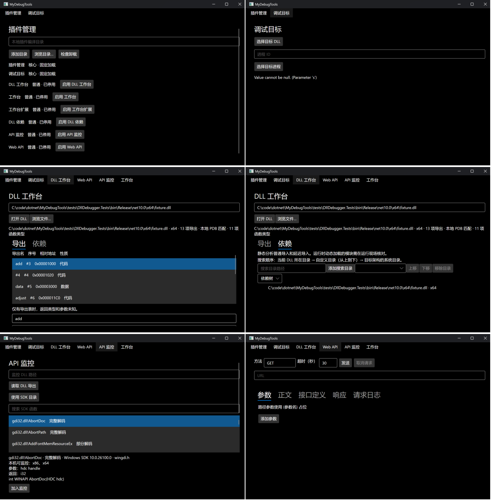
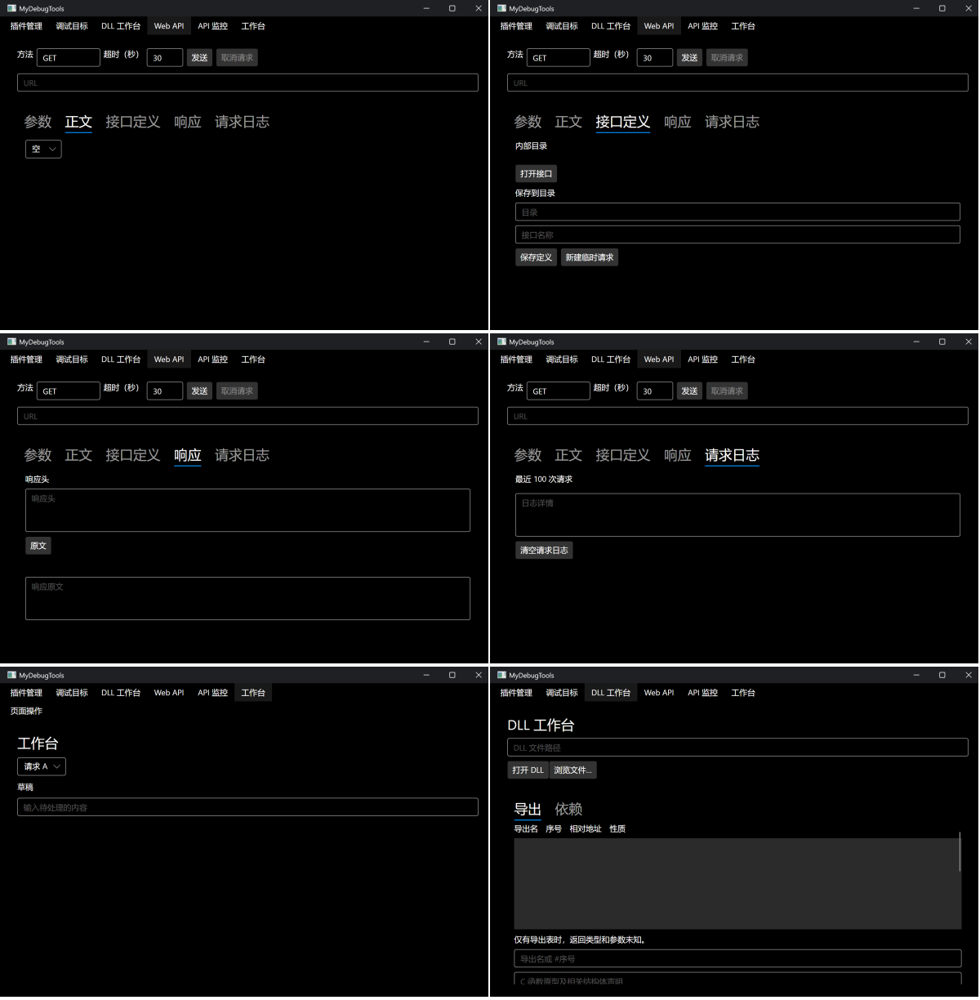

# 桌面界面走查 · 2026-11-21

从三个普通任务出发：「我手上有一个 DLL」「我想看程序调用了什么」「我有一个 URL 想试一下」。假设使用者知道自己的目标，了解工作所需的 DLL 或 HTTP 基础，第一次使用 MyDebugTools，也不知道其插件名称。

在 Windows x64 上复用本地 0004 发布版、隔离的空配置和已有 x64 样例，通过 Windows UI 自动化操作同一窗口。下图从该窗口直接取图，初始尺寸为 860 × 580 个逻辑像素，截图为 1720 × 1160 个物理像素。走查结束后已关闭该实例。下表中「窗口」指本次操作或截图，「代码」指按当前源码 `cef2849` 核对的分支。既有功能验收记录只作回归依据。

## 任务能否走通

| 严重度 | 位置（文件与行号） | 用户现在遇到什么 | 修改后应看到什么 | 原则与影响 |
| --- | --- | --- | --- | --- |
| HIGH | `src/Desktop/Shell.fs:96`、`:183`、`:240`、`samples/Workbench/Workbench.fs:35` | 窗口：首次打开只有插件管理和调试目标。插件列表把“工作台”“DLL 工作台”“工作台扩展”并列。启用 DLL 依赖也没有独立入口。 | 从“查看 DLL 导出或依赖”“监控程序调用”“发送 HTTP 请求”进入。按需启用时讲清所需插件和到达位置。示例单独标识。 | 可发现性。第一次发请求就要先理解插件关系。 |
| HIGH | `src/Desktop/Shell.fs:50`、`:72`、`src/Desktop/DllWorkbench.fs:67`、`src/ApiMonitor/Monitor.fs:110` | 窗口：空 PID 提交后只见英文参数异常。代码：选择目标后仅显示架构和运行时路径。工作台与监控各自取输入。 | 区分选 DLL 与选进程，显示实际文件名或进程与 PID。有效目标有明确后续入口。无效 PID 有中文字段提示，保留上一有效目标。 | 错误恢复和任务连续性。选完目标不应再猜哪一页会用它。 |
| HIGH | `src/Desktop/DllWorkbench.fs:98`、`:122`、`:148`、`src/Desktop/SignatureEditor.fs:15`、`src/Desktop/BindingPanel.fs:49` | 窗口：空 DLL 首屏已有空导出表。打开样例后首屏主要显示路径、导出和入口。代码：签名、JSON 实参、调用、代码生成依次堆在“导出”页。须读行语法才能手工补参数。 | 先选文件与函数，再按“调用函数”或“生成代码”显示所需步骤。在缺项处补齐并确认，保留声明粘贴与高级文本输入。 | 渐进呈现。会浏览的人应能停在导出表，想执行的人应能找到下一步。 |
| HIGH | `src/ApiMonitor/Monitor.fs:26`、`:87`、`:116`、`:126` | 窗口：当前已有 SDK 结果，最上面却是 DLL 路径。默认窗口看得到“加入监控”，看不到目标选择和采集状态。代码：无选中项时“移除”、无会话时“停止”均可无声返回。 | 明示函数来源和已选数。启动与附加按模式呈现。运行后会话状态、停止入口和记录一起可见。不可执行的操作就近说明条件。 | 系统状态可见。用户应知道自己在选函数、等待调用还是已经结束。 |
| HIGH | `src/WebApi/History.fs:77`、`src/WebApi/Definitions.fs:27`、`:52` | 窗口：空历史仍有“清空请求日志”。代码：有日志时按钮直接清空。“新建临时请求”或打开定义直接替换当前编辑内容。 | 空历史给出产生第一条日志的入口。有记录时先显示清空范围并可取消。有未保存改动时，新建或打开前可保留草稿，或由用户决定放弃。 | 控制权。一次误点会丢掉排查凭据或正在编辑的内容。 |
| HIGH | `src/Desktop/Shell.fs:94`、`:162`、`src/Desktop/DllWorkbench.fs:40`、`:121`、`src/Desktop/BindingPanel.fs:17`、`src/ApiMonitor/Monitor.fs:80`、`src/DllDependencies/Dependencies.fs:97`、`src/DllDependencies/Graph.fs:92`、`src/WebApi/Plugin.fs:34`、`src/WebApi/BodyEditor.fs:12`、`src/WebApi/ResponseView.fs:13` | 窗口及代码：错误、状态与部分结果是普通文本控件。已有“复制代码”，响应原文和日志详情也能选取，但目标报错、部分失败原因和采集详情没有一致的反馈复制入口。 | 每个失败处有易懂的原因、可行的下一步和“复制诊断信息”。复制成功可见。剪贴板写入失败时可选中同一份文本手动复制。 | 可反馈性。用户可以把一次失败交给别人定位，无须截图抄文字。 |

## 信息和操作是否好辨认

| 严重度 | 位置（文件与行号） | 用户现在遇到什么 | 修改后应看到什么 | 原则与影响 |
| --- | --- | --- | --- | --- |
| MEDIUM | `src/Desktop/Program.fs:10`、`src/Desktop/Shell.fs:47`、`:189`、`src/Desktop/DllWorkbench.fs:17`、`src/WebApi/Editor.fs:52`、`src/WebApi/Plugin.fs:89` | 窗口：管理页的“检查卸载”和“添加目录”一样醒目，HTTP 的“发送”排在 URL 上方。不同页面的相邻按钮有的贴边、有的留缝。 | 页标题、对象、主动作、次操作、结果采用同一阅读顺序。主动作有固定样式和位置。卸载诊断收进管理页的详细操作。 | 视觉层级与表面一致性。相同外形不应迫使用户逐个判断操作的重要性。 |
| MEDIUM | `src/Desktop/Shell.fs:81`、`:219`、`:99`、`samples/WorkbenchActions/Actions.fs:10` | 窗口及代码：目录仅有占位提示。“页面操作”另起一行，结果在窗口底部。重载和停用共用标题为“停用监控插件”的确认框。 | 在对应插件行展示来源、状态和反馈。扩展动作紧邻当前选项。重载确认写“结束采集并重新加载”，列出受影响会话。 | 操作与对象相邻。用户在执行前能预判结果。 |
| MEDIUM | `src/DllDependencies/Dependencies.fs:53`、`:71`、`src/DllDependencies/Labels.fs:5`、`src/DllDependencies/Graph.fs:64`、`:94` | 窗口及代码：搜索优先级藏在下拉框里，树行把路径、性质与问题串成一句。图的连线直接指定灰色和蓝色。 | 紧凑行给出模块名与状态。选择后查看完整路径、导入方和原因。按顺序列出目录。树和图共用结果，选中连线有主题适配及文字关系。 | 可扫描性。能回答“缺的是哪一个、谁依赖它、改目录后命中了谁”。 |
| MEDIUM | `src/WebApi/Editor.fs:22`、`:99`、`src/WebApi/BodyEditor.fs:30`、`src/WebApi/Plugin.fs:48`、`src/WebApi/Definitions.fs:48` | 窗口及代码：正文初始只见一个“空”。multipart 说明要求换到“参数”页。编辑时接口名称不常驻，部分字段填写后失去可见标签。 | 请求栏持续显示临时请求或定义名。字段有常驻标签。正文页能直接到对应字段并返回，能区分本次实参与保存的默认值。 | 识别胜于记忆。填写到一半仍能辨认当前操作的对象和用途。 |
| MEDIUM | `src/WebApi/ResponseView.fs:16`、`:41`、`src/WebApi/History.fs:65`、`src/Desktop/BindingPanel.fs:55` | 窗口及代码：尚未发送就显示空的响应头、原文框。响应模式用普通按钮切换。代码复制或导出成功缺少明确回执。 | 首次等待、空响应、传输失败各有说明。原文/格式化/静态预览有选中态。复制和保存完成后显示具体结果。 | 状态辨识。能区分“没有做”“完成但没有内容”和“失败”。 |

## 补充走查：连续操作与窗口管理

复用同一份本地发布版和样例，用独立配置在一次 Windows UI 自动化会话中打开 DLL、依赖、API 监控与 Web API。下表区分本轮实际复现的结果和阅读代码得出的判断。

| 严重度 | 位置 | 改版前的证据 | 用户应能完成的动作 | 用户影响 |
| --- | --- | --- | --- | --- |
| HIGH | `src/Desktop/DllWorkbench.fs:53`、`src/Desktop/SignatureEditor.fs:24` | 实测：把 add 的调用约定从 cdecl 改为 stdcall，未保存，切到 adjust 再返回，字段已回到 cdecl。 | 返回 add 时找回标记为待确认的输入，或在离开前主动决定放弃。 | 查看另一个函数作对照会丢掉正在做的工作。 |
| HIGH | `src/WebApi/Definitions.fs:52`、`src/WebApi/Plugin.fs:81`、`src/WebApi/History.fs:66` | 实测：填好 URL 后点“新建临时请求”，立即变为空白。代码：收到响应会强制选中响应页；日志每次刷新默认第一条。 | 新建时可保留草稿，同时保留正在阅读的记录或页面，完成状态就近提示。 | 输入会丢失，长响应到达时也会打断其他操作。 |
| MEDIUM | `src/Desktop/Shell.fs:209`、`src/Host/LocalPlugins.fs:12`、`src/Host/LocalPlugins.fs:115` | 代码及前轮窗口：逐行显示插件名和启停按钮。目录清单只声明标识、名称、程序集和入口类型。随附普通插件与开发目录都登记了位置，缺少 ZIP 加载和来源专属的移除操作。 | 一张表里找齐所有插件，沿提供的界面展开扩展，清楚区分卸载包与解除目录关联。 | 用户难以预判扩展出现在哪里、清理操作会碰哪些文件。 |
| MEDIUM | `src/Desktop/Shell.fs:91`、`src/Desktop/Shell.fs:129`、`src/Desktop/Shell.fs:256` | 代码及前轮窗口：导航换页时替换一个中央内容控件。页面实例虽有缓存，同时可见区域仍只有一处。 | 让用户保留一个主编辑区，把正在对照的结果放在旁边，关错面板可从菜单找回。 | 来回换页既费操作，也迫使人记住刚看过的值。 |
| MEDIUM | `src/Desktop/BindingPanel.fs:34`、`src/Desktop/DllWorkbench.fs:139` | 代码：按复制或导出时会重新生成代码；切换函数时结果文字没有同步标记其归属。 | 看到有效预览再复制，切函数后仍能辨识哪一次调用产生了结果。 | 手头的内容可能和刚刚核对的预览或当前选择不对应。 |
| MEDIUM | `src/DllDependencies/Dependencies.fs:74`、`src/DllDependencies/Graph.fs:86` | 实测：Root.dll 下能找到缺失的 Choice.dll。代码：树和图共用解析结果，但图初次从根节点开始，没有传入树中的选择。 | 从缺失项带着当前节点进入另一种视图，再对照目录调整后的命中。 | 分析已经完成，用户仍需再找一次模块。 |
| MEDIUM | `src/ApiMonitor/Monitor.fs:38`、`src/ApiMonitor/Monitor.fs:58`、`src/ApiMonitor/Monitor.fs:91` | 实测：搜索无匹配项且没有会话时，“加入监控”禁用，“移除选中函数”“停止所选会话”仍可按。代码：调用列表刷新按旧行号恢复，缺少查看结果的筛选入口。 | 无对象时操作状态明确；持续更新时按函数或线程查看已有记录并保持位置。 | 用户难以判断按钮为何无响应，数据多时难以持续阅读。 |

ZIP 安装、依赖树表和 Dock 是这次新增的产品能力。库适配、浮窗重载以及新版流程的真人试用尚待实施验收。上述复查已关闭测试进程。

## 核验边界

首轮在窗口中查看了管理、空 PID、示例工作台、DLL 打开前后、依赖树、监控首屏及 Web API 五个页签。补充走查实测了签名草稿切换和新建临时请求。图视图、代码生成的详细交互、采集生命周期、插件重载对话框和有数据的 HTTP 分支按源码及各功能原有验收记录核对。此次没有执行目标代码或发起真实采集。

**Not verified（本轮未实测）**：真人首次使用的完成率、窄窗与不同主题的实测对比度、键盘全链路、系统减少动态效果、剪贴板失败与完整反馈粘贴。这些项目列入新规格验收。截图反映本机当时的主题，不能据此断言其他主题也有相同表现。

**Block** · 首次入口、出错恢复和反馈复制仍有 HIGH 项，当前界面未达到本次提出的产品体验要求。
